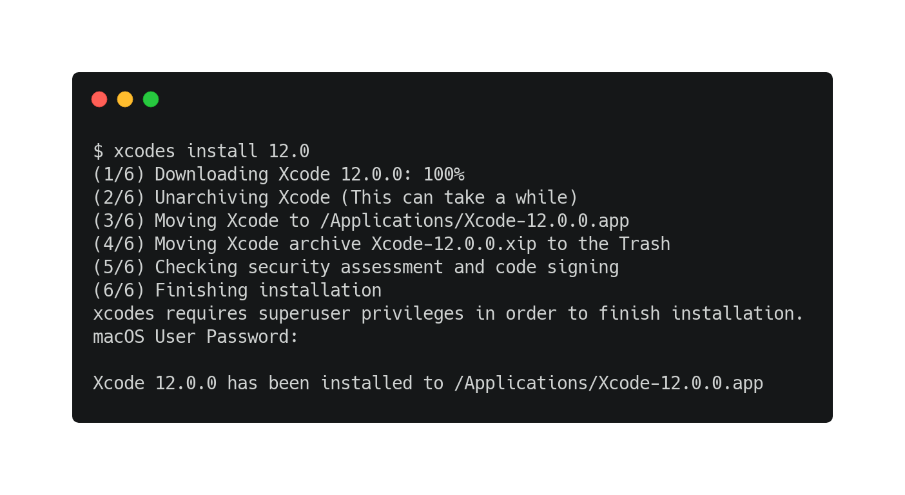
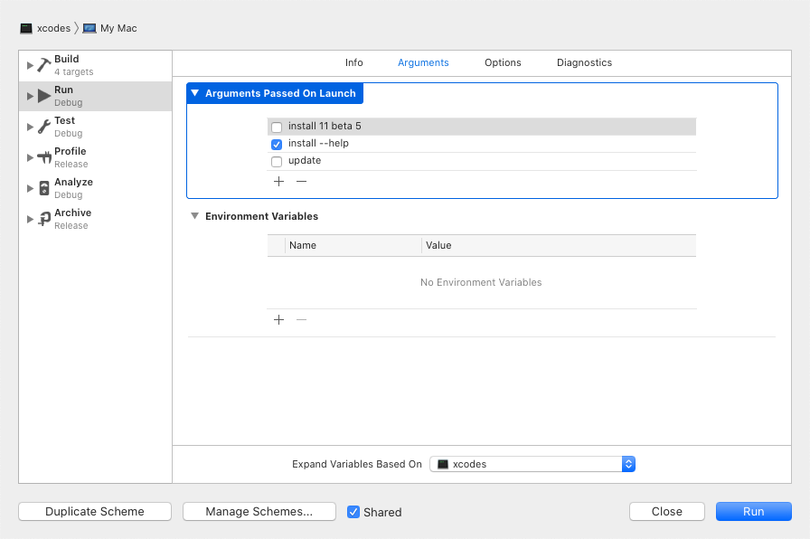

# xcodes

The best command-line tool to install and switch between multiple versions of Xcode.

_If you're looking for an app version of `xcodes`, try [Xcodes.app](https://github.com/XcodesOrg/XcodesApp)._




### :tada: Announcement

Xcodes is now part of the `XcodesOrg` - [read more here](nextstep.md)

## Installation

### Homebrew (Preferred)

```sh
brew install xcodesorg/made/xcodes
```

These are Developer ID-signed and notarized release builds and don't require Xcode to already be installed in order to use.

**Other methods:**

<details>
<summary>Download a release</summary>

Download the latest release from the [Releases](https://github.com/XcodesOrg/xcodes/releases) page. These are Developer ID-signed release builds and don't require Xcode to already be installed in order to use.
</details>

<details>
<summary>Using <a href="https://github.com/yonaskolb/Mint">Mint</a></summary>

```sh
mint install XcodesOrg/xcodes
```

</details>

<details>
<summary>Build from source</summary>

Building from source requires a Swift 6.0 or newer toolchain (Xcode 16 or later).
The package declares macOS 13 as its minimum macOS deployment target; the selected
Xcode version may require a newer macOS version to run. Install and select a full
Xcode installation before building, so this is not an option for setting up a
computer from scratch. Swift Package Manager downloads dependencies automatically.

```sh
git clone https://github.com/XcodesOrg/xcodes
cd xcodes
make install
# Or install into a user-owned directory
make install prefix="$HOME/.local"
```

The default installation location is `/usr/local/bin/xcodes`, which must be
writable. The Makefile variable is lowercase `prefix`, not `PREFIX`; executables
are installed into `<prefix>/bin`. Add that directory to your `PATH` if needed.
You can also override `bindir` directly.

`make` builds without installing. Both `make` and `make install` produce a
universal arm64 and x86_64 executable using release configuration, with Swift
optimization disabled (`-Onone`) as a historical compiler workaround and the
build sandbox disabled. Local builds and installation do not invoke the
Makefile's Developer ID signing or notarization steps.

#### Build output path troubleshooting

The Makefile expects `.build/apple/Products/Release/xcodes`. Some toolchains
instead produce `.build/out/Products/Release/xcodes`, also accessible through
the `.build/release` symlink. If the build succeeds but installation reports
`No such file or directory` for the expected executable, check the build output
and override `RELEASEBUILDDIR` with the actual executable path:

```sh
make install prefix="$HOME/.local" \
  RELEASEBUILDDIR="$PWD/.build/out/Products/Release/xcodes"
"$HOME/.local/bin/xcodes" version
"$HOME/.local/bin/xcodes" --help
```

This override was verified with an installation into a temporary prefix:
the installed executable contained both arm64 and x86_64 architectures, reported
version `2.1.0`, and successfully displayed help. The default build succeeded,
but installation required the path override on that toolchain. A warning about
x86_64 being deprecated for the active macOS 27.0 deployment target did not
prevent the universal build from completing. These were build and CLI smoke
checks, not a test-suite run.

Run `make clean` to remove `.build`, including downloaded dependency checkouts.
To remove an installed executable, run `make uninstall` with the same `prefix`
or `bindir` used for installation, for example `make uninstall prefix="$HOME/.local"`.
Cleaning build artifacts does not uninstall the executable.

While installing, you may get the following output:

```sh
swift build
error: terminated(72): xcrun --sdk macosx --find xctest output:
```

If that occurs, select a full Xcode installation with `xcode-select` or by choosing a Command Line Tools option in Xcode's Settings > Locations tab. Use `swift --version` and `xcode-select --print-path` to check the active toolchain.
</details>

## Usage

### Install Xcode : 

Install a specific version of Xcode using a command like one of these:

```sh
xcodes install 10.2.1
xcodes install 11 Beta 7
xcodes install 11.2 GM seed
xcodes install 9.0 --path ~/Archive/Xcode_9.xip
xcodes install 27.3 Beta --path ~/Archive/Xcode_27.3_beta.aea
xcodes install --latest-prerelease
xcodes install --latest --directory "/Volumes/Bag Of Holding/"
xcodes install --latest --experimental-unxip
```

Installing an `.aea` archive requires macOS with `archiveutil extractXcodeAEA`. If Xcode Releases has an outdated link, try installing with `--data-source apple`.

You'll then be prompted to enter your Apple ID username and password. You can also provide these with the `XCODES_USERNAME` and `XCODES_PASSWORD` environment variables.

After successfully authenticating, xcodes will save your Apple ID password into the keychain and will remember your Apple ID for future use. If you need to use a different Apple ID than the one that's remembered, set the `XCODES_USERNAME` environment variable.

xcodes will download and install the version you asked for so that it's ready to use.

```sh
(1/6) Downloading Xcode 11.2.0: 100%
(2/6) Unarchiving Xcode (This can take a while)
(3/6) Moving Xcode to /Applications/Xcode-11.2.0.app
(4/6) Moving Xcode archive Xcode-11.2.0.xip to the Trash
(5/6) Checking security assessment and code signing
(6/6) Finishing installation
xcodes requires superuser privileges in order to finish installation.
macOS User Password:

Xcode 11.2.0 has been installed to /Applications/Xcode-11.2.0.app
```

If you have [aria2](https://aria2.github.io) installed (it's available in Homebrew, `brew install aria2`), then xcodes will default to use it for downloads. It uses up to 16 connections to download Xcode 3-5x faster than URLSession.

Xcode will be installed to /Applications by default, but you can provide the path to a different directory with the `--directory` option or the `XCODES_DIRECTORY` environment variable. All of the xcodes commands support this option, like `select` and `uninstall`, so you can manage Xcode versions that aren't in /Applications. xcodes supports having all of your Xcode versions installed in _one_ directory, wherever that may be.

### Architectures

The `list` and `runtimes` commands show architecture availability when Apple provides it. Universal downloads are labeled `[Universal]`, Apple Silicon-only downloads are labeled `[Apple Silicon]`, and Intel-only downloads are labeled `[Intel]`.

You can filter either list by architecture or variant with `--architecture arm64`, `--architecture x86_64`, `--architecture appleSilicon`, or `--architecture universal`. These filters are exact: `arm64` and `appleSilicon` show Apple Silicon-only downloads, `x86_64` shows Intel-only downloads, and `universal` shows downloads that support both architectures. The option can be used multiple times.

```sh
xcodes list --architecture arm64
xcodes list --architecture universal
xcodes runtimes --architecture arm64 --architecture universal --include-betas
```

### Install Runtimes : 

Run this command line to display the available runtimes 

```sh
xcodes runtimes --include-betas
```

Install the wanted Runtime (ex. iOS 17.0-beta1)

```sh
xcodes runtimes install "iOS 17.0-beta1"
```

### `.xcode-version`

We recommend the creation of a `.xcode-version` file to explicitly declare and store the Xcode version to be used by your CI environment as well as your team.

```txt
13.4.1
```

Read [the proposal](/XCODE_VERSION.md) of `.xcode-version`.

### Commands

- `download <version>`: Download a specific version of Xcode
- `install <version>`: Download and install a specific version of Xcode
- `installed`: List the versions of Xcode that are installed
- `icon`: Draw the version onto the icon of installed Xcodes, like "27.2" (see below)
- `list`: List all versions of Xcode that are available to install
- `select`: Change the selected Xcode
- `uninstall`: Uninstall a specific version of Xcode
- `update`: Update the list of available versions of Xcode
- `version`: Print the version number of xcodes itself
- `signout`: Clears the stored username and password

### Version badges on Xcode icons

To tell several installed Xcodes apart in the Dock, `xcodes icon` draws each Xcode's version onto its icon. The pill is green for releases and purple for prereleases, which also get a suffix such as "27.2b2" (beta 2) or "27.2rc" (release candidate):

```sh
xcodes icon                # every Xcode in /Applications
xcodes icon 27.2           # just one
xcodes icon --remove       # restore the original icons
xcodes install --latest --badge-icon
```

The badge is a custom Finder icon stored beside the app's `Contents` folder, so Xcode's code signature isn't modified and `spctl`/`codesign --verify` still pass. `codesign --verify --strict` does report the Finder info it adds, so use `xcodes icon --remove` if you run strict checks. Dock tiles of already-running Xcodes update the next time they launch; run `killall Dock` if a pinned tile looks stale.

### Experimental Unxip - for faster unxipping

Thanks to the amazing work by [saagarjhi](https://github.com/saagarjha/unxip) - Xcodes now includes the ability to unxip up to 70% faster on some systems.

```sh
xcodes install --latest --experimental-unxip
```

### Shell Completion Scripts

xcodes can generate completion scripts which allow you to press the tab key on your keyboard to autocomplete commands and arguments when typing an xcodes command. The steps to install a completion script depend on the shell that you use. More information about installation instructions for different shells and the underlying implementation is available in the [swift-argument-parser repo](https://github.com/apple/swift-argument-parser/blob/main/Sources/ArgumentParser/Documentation.docc/Articles/InstallingCompletionScripts.md).

<details>
<summary>Zsh, with oh-my-zsh:</summary>

Run the following commands:

```sh
mkdir ~/.oh-my-zsh/completions
xcodes --generate-completion-script > ~/.oh-my-zsh/completions/_xcodes
```

</details>

## Development

You'll need Swift 6.0 or newer (Xcode 16 or later) to build and run xcodes.
See [Build from source](#installation) for installation prerequisites and
Makefile troubleshooting. The `.swift-version` file still contains the historical
value `5.3`; use the tools version declared in `Package.swift` as the requirement.

<details>
<summary>Using Xcode</summary>
Even though xcodes is a command-line app, all of the normal functionality works in Xcode, like building, running, and running tests. You can even type text into Xcode's console when it prompts you for input like your Apple ID or 2FA code.

When running xcodes from Xcode, if you want to run a particular command or pass some arguments, you can hold the option key to present a sheet with more options. This means you'd use <kbd>Option</kbd> + <kbd>Command</kbd> + <kbd>R</kbd> or hold <kbd>Option</kbd> while clicking the Run button. Here you can add, remove, and toggle arguments that will be passed to xcodes when it's launched.


</details>

<details>
<summary>Using Swift command line tools</summary>
You can also use the Swift command line tools once you have Xcode installed:

- Build: `swift build`
- Run: `swift run`, or commands like `swift run xcodes list`
- Run tests: `swift test`

</details>

There's a Makefile to help build xcodes for distribution. We already do this for you in order to provide Developer ID-signed and notarized release builds via Homebrew (see [Installation](#installation)).
The `sign`, `zip`, `bottle`, and `notarize` targets use a hardcoded maintainer
signing identity and require the corresponding certificate and private key.
They are not necessary for local development or installation.

<details>
<summary>Releasing a new version of xcodes</summary>

```sh
# Bump the version number in Version.swift, commit the change, and tag it
vim Sources/XcodesKit/Version.swift
git add Sources/XcodesKit/Version.swift
git commit -m "Bump version to $VERSION"
git tag -asm "$VERSION" "$VERSION"

# Run the release automation
./release.sh --version "$VERSION" --team-id "ABC123"

# Or run the release steps manually:
# Clean first
make clean

# Make a release build of xcodes, sign it, and zip it
make zip
# Create a Homebrew bottle
make bottle VERSION="$VERSION"

# Duplicate the Homebrew bottle for all expected platform filenames
cp "xcodes-$VERSION.mojave.bottle.tar.gz" "xcodes-$VERSION.arm64_mojave.bottle.tar.gz"
cp "xcodes-$VERSION.mojave.bottle.tar.gz" "xcodes-$VERSION.macos.i386.bottle.tar.gz"
cp "xcodes-$VERSION.mojave.bottle.tar.gz" "xcodes-$VERSION.macos.arm64.bottle.tar.gz"

# Notarize the release build
# This can take a while
make notarize \
    TEAMID="ABC123"

# Push the new version bump commit and tag when ready
git push --follow-tags

# Edit the draft release created by Release Drafter to point at the new tag
# Set the release title to the new version
# Add the xcodes.zip and xcodes-$VERSION.*.bottle.tar.gz files to the release
# Publish the release

# Update the Homebrew Bottle: https://github.com/XcodesOrg/homebrew-made/blob/master/Formula/xcodes.rb
```

</details>

Notable design decisions are recorded in [DECISIONS.md](./DECISIONS.md). The Apple authentication flow is described in [Apple.paw](./Apple.paw), which will allow you to play with the API endpoints that are involved using the [Paw](https://paw.cloud) app.

[`xcode-install`](https://github.com/xcpretty/xcode-install) and [fastlane/spaceship](https://github.com/fastlane/fastlane/tree/master/spaceship) both deserve credit for figuring out the hard parts of what makes this possible.

## Maintainers

[Matt Kiazyk](https://github.com/mattkiazyk) - [Twitter](https://www.twitter.com/mattkiazyk)
